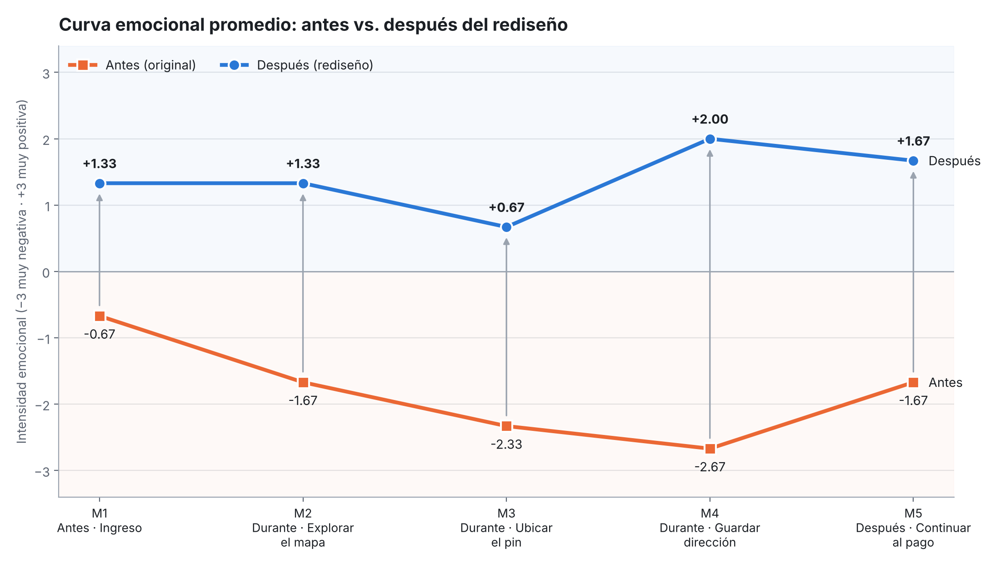
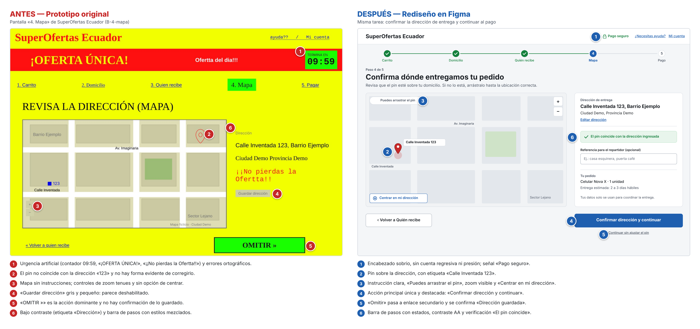

# Evaluación y rediseño de la experiencia emocional del usuario

**Asignatura:** Interacción Humano Computador · 5.º semestre, paralelo A · UTA – FISEI
**Docente:** Ing. José Caiza, Mg.
**Caso de estudio:** pantalla «4. Mapa» del prototipo SuperOfertas Ecuador ([B-4-mapa](https://github.com/juANO2202/HCI-2026-G1/blob/main/prototipos/original/B-4-mapa.png.jpeg), repositorio del Grupo 1)
**Tarea evaluada:** confirmar en el mapa que el pedido llegará a *Calle Inventada 123, Barrio Ejemplo* y continuar al pago.

**Rediseño en Figma:** [abrir archivo](https://www.figma.com/design/PHOSZzHbtGcVhKMXvtzVrq/T2.1-Experiencia-emocional?node-id=0-1)
**Informe final:** [informe/informe_final.pdf](informe/informe_final.pdf)

## Integrantes, roles y contribuciones

| Integrante | Rol | Tareas realizadas | Archivos |
|---|---|---|---|
| González Álvarez Vladimir Humberto | Coordinación y moderación | Moderación y registro de las sesiones, informe final y README | `README.md`, `informe/`, `evidencias/pruebas_usuarios/` |
| Acaro Ibujés Pedro Sebastián | Inspección y evidencias | Tarea, cinco momentos de interacción, capturas numeradas y matriz UX | `evidencias/original/`, `matriz/` |
| Mora Beltrán Santiago Sebastián | Medición | Datos de las pruebas, curvas emocionales y métricas antes/después | `curva_emocional/` |
| Vinces Cueva Boris Yussef | Rediseño | Rediseño en Figma y comparación visual antes/después | `rediseño/` |

## Momentos de interacción

| Código | Fase | Momento |
|---|---|---|
| M1 | Antes | Ingreso a la pantalla «4. Mapa» |
| M2 | Durante | Explorar el mapa y leer la dirección |
| M3 | Durante | Ubicar o ajustar el pin |
| M4 | Durante | Guardar la dirección |
| M5 | Después | Continuar al pago |

## Hallazgos principales

- Con el prototipo original la curva emocional es negativa en todo el recorrido (promedio **−1,80**).
- **Momentos críticos:** M4 · Guardar dirección (**−2,67**) y M3 · Ubicar el pin (**−2,33**). El botón «Guardar dirección» parece deshabilitado frente a «OMITIR »», y el pin no coincide con la dirección. Los grupos 1, 4 y 5 de la clase reportaron lo mismo.
- **Rediseño:** seis modificaciones (encabezado sin urgencia artificial, pin sobre la dirección, instrucciones del mapa, acción principal única, confirmación de guardado y contraste AA).
- **Validación:** promedio **+1,40**; éxito de 0,50 a 1,00; tiempo de 105 s a 31 s (−70 %); facilidad percibida (SEQ) de 2,33 a 5,67.





## Estructura

```
Tarea_Experiencia_Emocional_UX/
├── README.md
├── evidencias/
│   ├── original/            # captura original, contexto del flujo y capturas C1–C5
│   └── pruebas_usuarios/    # protocolo, perfiles y sesiones P1–P3
├── curva_emocional/
│   ├── curva_emocional.png  # curva del prototipo original
│   ├── curva_despues.png
│   └── comparacion_curvas.png
├── matriz/
│   └── matriz_ux.xlsx
├── rediseño/
│   ├── antes_despues.png
│   └── enlace_figma.md
└── informe/
    └── informe_final.pdf
```

Los participantes se identifican solo con códigos (P1–P3); no se publican nombres ni datos personales.
